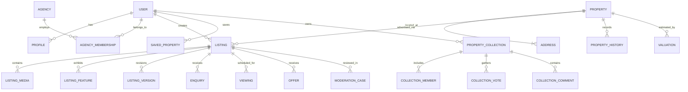

# Dynasty Estates - Entity Relationship Diagram & Domain Model

**Organisation:** Tricore Enterprises  
**Platform:** Dynasty Estates  
**Version:** 1.0  
**Phase:** 0 - Product Definition and Architecture  
**Date:** September 2026  

---

## 1. Mandatory Architectural Principle: Property vs. Listing Separation

A fundamental requirement of Dynasty Estates is the strict separation between the **Physical Property** (an enduring physical asset with geographic coordinates, erf size, and immutable location) and the **Listing** (a commercial advertisement created by a seller or agent for a specific period).

```text
Physical Property (e.g. 14 Protea Lane, Waterkloof)
  │
  ├── Historical Listing (2022 - Sold for R4,200,000)
  ├── Historical Listing (2024 - Rented for R28,000/mo)
  └── Active Listing (2026 - Asking R4,850,000)
```

---

## 2. Core Entities & Schema Definitions



### 2.1 Identity & Organization Domain

#### `User`
- `id`: UUID (Primary Key)
- `email`: String (Unique, Indexed)
- `phone`: String (E.164 format)
- `role`: Enum (`anonymous`, `buyer`, `renter`, `seller`, `landlord`, `agent`, `agency_admin`, `moderator`, `admin`)
- `is_verified`: Boolean
- `created_at`: Timestamp
- `updated_at`: Timestamp

#### `Profile`
- `user_id`: UUID (Foreign Key -> User.id)
- `full_name`: String
- `avatar_url`: String
- `bio`: Text
- `preferred_currency`: String (Default: 'ZAR')
- `preferred_language`: String (Default: 'en-ZA')

#### `Agency`
- `id`: UUID (Primary Key)
- `name`: String
- `registration_number`: String (CIPC)
- `eaab_ffc_number`: String (Property Practitioners Regulatory Authority / PPRA)
- `logo_url`: String
- `verified`: Boolean
- `created_at`: Timestamp

---

### 2.2 Property & Listing Domain

#### `Property` (Enduring Physical Asset)
- `id`: UUID (Primary Key)
- `property_type`: Enum (`house`, `apartment`, `townhouse`, `estate_home`, `farm`, `commercial`, `land`)
- `erf_size_sqm`: Decimal
- `floor_size_sqm`: Decimal
- `bedrooms`: Integer
- `bathrooms`: Decimal
- `parking_spaces`: Integer
- `address_id`: UUID (Foreign Key -> Address.id)
- `created_at`: Timestamp

#### `Address` & `GeoPoint`
- `id`: UUID (Primary Key)
- `street_number`: String
- `street_name`: String
- `suburb`: String
- `city`: String (e.g. Pretoria, Cape Town, Johannesburg, Durban)
- `province`: Enum (`Gauteng`, `Western Cape`, `KwaZulu-Natal`, `Eastern Cape`, etc.)
- `postal_code`: String
- `country`: String (Default: 'South Africa')
- `location`: Geography(Point, 4326) (Longitude, Latitude)

#### `Listing` (Commercial Advertisement)
- `id`: UUID (Primary Key)
- `property_id`: UUID (Foreign Key -> Property.id)
- `creator_user_id`: UUID (Foreign Key -> User.id)
- `agency_id`: UUID (Nullable, Foreign Key -> Agency.id)
- `listing_type`: Enum (`for_sale`, `to_rent`, `commercial_sale`, `commercial_lease`, `development`)
- `asking_price`: Decimal (ZAR)
- `rental_period`: Enum (`monthly`, `weekly`, `annual`) (Nullable)
- `monthly_levy`: Decimal (Nullable)
- `rates_and_taxes`: Decimal (Nullable)
- `title`: String
- `description`: Text
- `status`: Enum (`draft`, `submitted`, `needs_changes`, `approved`, `published`, `under_offer`, `sold`, `rented`, `paused`, `archived`)
- `quality_score`: Integer (0 - 100)
- `is_featured`: Boolean
- `published_at`: Timestamp (Nullable)
- `created_at`: Timestamp
- `updated_at`: Timestamp

#### `ListingMedia`
- `id`: UUID (Primary Key)
- `listing_id`: UUID (Foreign Key -> Listing.id)
- `media_type`: Enum (`photo`, `floorplan`, `video`, `virtual_tour_360`)
- `url`: String
- `thumbnail_url`: String
- `display_order`: Integer
- `perceptual_hash`: String (For duplicate & near-duplicate detection)
- `ai_detected_room`: String (e.g., 'kitchen', 'master_bedroom', 'patio')
- `ai_tags`: Array[String]
- `created_at`: Timestamp

---

### 2.3 Buyer Collaboration & Engagement Domain

#### `PropertyCollection`
- `id`: UUID (Primary Key)
- `owner_user_id`: UUID (Foreign Key -> User.id)
- `title`: String (e.g. "Our First Home", "Investment Shortlist")
- `description`: Text
- `is_private`: Boolean
- `created_at`: Timestamp

#### `CollectionMember`
- `collection_id`: UUID (Foreign Key -> PropertyCollection.id)
- `user_id`: UUID (Foreign Key -> User.id)
- `role`: Enum (`owner`, `collaborator`, `viewer`)

#### `CollectionVote`
- `collection_id`: UUID
- `listing_id`: UUID
- `user_id`: UUID
- `vote`: Enum (`like`, `love`, `reject`)
- `created_at`: Timestamp

#### `CollectionComment`
- `id`: UUID (Primary Key)
- `collection_id`: UUID
- `listing_id`: UUID
- `user_id`: UUID
- `comment_text`: Text
- `created_at`: Timestamp

---

### 2.4 Transaction, Moderation & Audit Domain

#### `Enquiry` & `Lead`
- `id`: UUID (Primary Key)
- `listing_id`: UUID (Foreign Key -> Listing.id)
- `inquirer_user_id`: UUID (Nullable for guest enquiries)
- `contact_name`: String
- `contact_email`: String
- `contact_phone`: String
- `message`: Text
- `status`: Enum (`new`, `responded`, `closed`)
- `created_at`: Timestamp

#### `Viewing`
- `id`: UUID (Primary Key)
- `listing_id`: UUID (Foreign Key -> Listing.id)
- `user_id`: UUID (Foreign Key -> User.id)
- `proposed_date_time`: Timestamp
- `status`: Enum (`requested`, `confirmed`, `rescheduled`, `cancelled`, `completed`)
- `notes`: Text

#### `ModerationCase`
- `id`: UUID (Primary Key)
- `listing_id`: UUID (Foreign Key -> Listing.id)
- `moderator_user_id`: UUID (Nullable)
- `status`: Enum (`pending`, `in_review`, `approved`, `changes_requested`, `rejected`)
- `feedback_notes`: Text
- `duplicate_flags`: JSONB
- `created_at`: Timestamp

#### `AuditLog`
- `id`: UUID (Primary Key)
- `actor_user_id`: UUID
- `action`: String (e.g. `listing.status_change`, `user.role_upgrade`, `moderation.decision`)
- `target_resource`: String
- `ip_address`: String
- `user_agent`: String
- `payload_diff`: JSONB
- `created_at`: Timestamp

