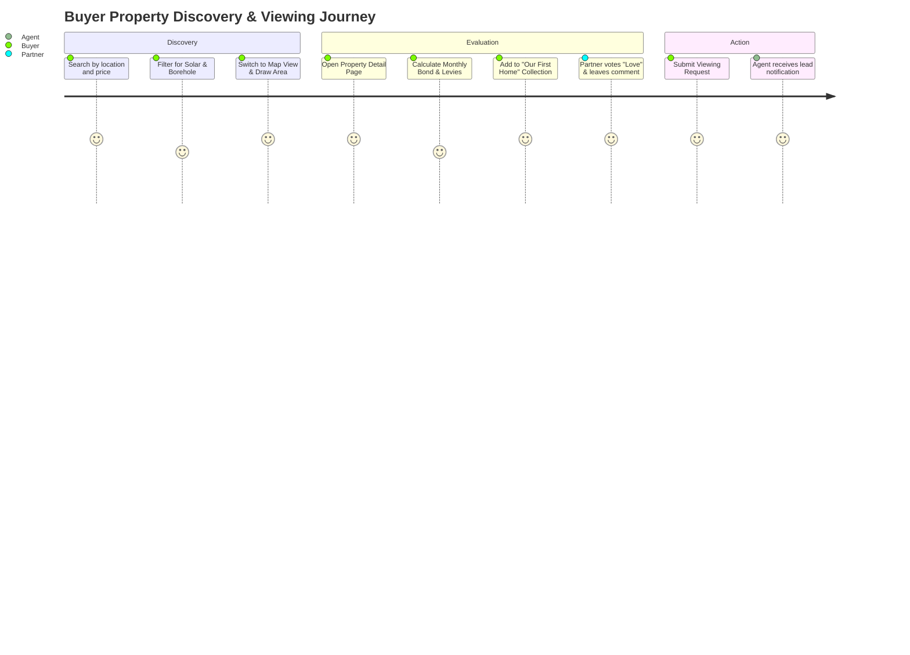

# Dynasty Estates - Product Requirements Document & Functional Specification

**Organisation:** Tricore Enterprises  
**Platform:** Dynasty Estates  
**Version:** 1.0  
**Phase:** 0 - Product Definition and Architecture  
**Date:** September 2026  

---

## 1. Executive Summary & Vision

Dynasty Estates is a premium South African property discovery, intelligence, and transaction platform designed to establish a new engineering and product benchmark in PropTech.

### Strategic Position
> **Property discovery + property intelligence + artificial intelligence + premium user experience.**

The platform addresses long-standing limitations in legacy portals (such as Property24 and Private Property) by combining traditional parameter-driven search with natural language semantic queries, geospatial boundary drawing, commute/lifestyle radius analysis, computer-vision similarity matching, and collaborative shortlisting.

---

## 2. Target Users & Personas

| Persona | Role Key | Primary Goals & Value Proposition |
|---|---|---|
| **Anonymous Visitor** | `anonymous` | High-speed, frictionless property search, map browsing, view property details, mortgage calculations. |
| **Buyer** | `buyer` | Save properties and searches, create shared Collections with family/partners, compare properties side-by-side, request viewings, ask AI Concierge. |
| **Renter** | `renter` | Filter verified rental listings, calculate total cost of tenancy (deposit, rent, utilities), schedule viewings, submit tenancy applications. |
| **Private Seller** | `seller` | Multi-step self-service listing creation wizard, automated AI tagging, Listing Quality Score, lead management, real-time impression analytics. |
| **Landlord** | `landlord` | Manage rental portfolio, screen enquiries, track listing lifecycle (Draft → Published → Rented). |
| **Property Practitioner / Agent** | `agent` | Agency affiliation, listing management, verified practitioner badge, instant lead response inbox, performance metrics. |
| **Agency Administrator** | `agency_admin` | Team roster management, branch performance analytics, lead routing, agency profile branding. |
| **Platform Moderator** | `moderator` | Review listing submissions, inspect duplicate media alerts, verify property documentation, approve or reject with actionable feedback. |
| **Platform Administrator** | `admin` | System configuration, user verification, fraud signals review, audit log inspection, CMS and taxonomy governance. |

---

## 3. MVP Scope Boundaries

### In Scope (MVP Core)
1. **Discovery & Search**:
   - Structured filter search (Location, Price, Beds, Baths, Parking, Property Type, South African amenity taxonomy).
   - Interactive map search with coordinate clustering and viewport synchronization.
   - Natural language search query parsing foundation.
2. **Property Details**:
   - Media gallery (high-res images, floorplans, video embeds).
   - True Cost monthly bond & ownership calculator (repayment, rates, taxes, levies).
   - Agent/seller inquiry and viewing booking modals.
3. **Buyer Collaboration**:
   - Saved properties and saved search alerts.
   - Collaborative Collections (invite partner/peer, vote: Like / Love / Reject, threaded comments).
   - Side-by-side property comparison matrix.
4. **Seller Listing Lifecycle**:
   - Multi-stage autosaving listing wizard (Category, Location, Details, Features, Pricing, Media, Disclosures, Preview).
   - Clear lifecycle states: `draft`, `submitted`, `approved`, `published`, `under_offer`, `sold`, `rented`, `archived`.
5. **Agent & Seller Console**:
   - Authenticated console with listings portfolio, leads inbox, viewing requests.
   - Listing Quality Score with actionable recommendations.
6. **Design & Identity**:
   - Obsidian Glass design system in Dark and Light themes with WCAG 2.1 AA accessibility compliance.
   - Role-based access control (RBAC) enforced server-side.

### Out of Scope (Post-MVP / Staged Roadmap)
- Real-time title deed registry integration via automated deeds office API (progressive manual document verification used initially).
- In-app digital conveyancing and bond origination banking integrations (referral and document collection only in MVP).
- Full 3D NeRF / Matterport automated generation pipeline (third-party iframe embed supported).

---

## 4. Primary User Journeys

### 1. Buyer Collaboration Journey
1. Buyer searches Pretoria East properties with solar and double garage.
2. Saves top 3 candidates to a new Collection titled *"Family Home 2026"*.
3. Invites spouse via email link.
4. Spouse reviews Collection on mobile/desktop, votes "Love" on candidate #1 and "Reject" on candidate #3.
5. Buyer triggers "Schedule Viewing" for Saturday 11:00 AM.
6. Seller/Agent receives viewing inquiry in dashboard.

### 2. Seller Listing & Moderation Journey
1. Private Seller registers and enters the Listing Creation Wizard.
2. Fills property basics: Erf size 950m², 4 beds, 3 baths, pool, 8kW solar inverter.
3. Uploads 12 photographs with drag-and-drop ordering.
4. System calculates Listing Quality Score (88/100) and recommends adding a floorplan.
5. Seller previews listing in Obsidian Glass card and detail preview mode.
6. Submits for moderation (status changes from `draft` to `submitted`).
7. Moderator dashboard receives submission, checks address and media uniqueness, and clicks "Approve & Publish".
8. Listing is live and searchable across the platform.

---

## 5. Non-Functional Requirements

- **Performance**: Largest Contentful Paint (LCP) < 2.2s on desktop, < 2.8s on 4G mobile; initial bundle < 180kB gzip.
- **Accessibility**: WCAG 2.1 AA compliance across all public and authenticated routes, semantic HTML, ARIA landmarks, keyboard navigable, screen-reader verified.
- **Security & POPIA**: Data minimisation, encrypted transport (HTTPS / TLS 1.3), hashed passwords, fine-grained database authorization rules, no PII leakage in analytics or logs.
- **Reliability**: Graceful offline / error handling for network interruptions, database disconnects, or third-party service failures.

